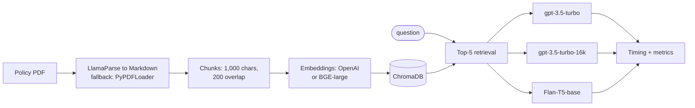

# RAG Policy QA, and What Its Evaluation Got Wrong

**A RAG pipeline that answers questions about an insurance policy (LIC New Jeevan Shanti), compared across three LLMs, with an evaluation whose numbers turned out to be more instructive than the models.**

[](https://colab.research.google.com/github/dojedaro/openai-rag-policy-qa-evaluation/blob/main/RAG_Systems_project.ipynb)
[](https://github.com/dojedaro/openai-rag-policy-qa-evaluation/actions/workflows/notebooks.yml)

> Part of a series of RAG projects: [strict PDF QA](https://github.com/dojedaro/strict-pdf-question-answering) ·
> [PDF RAG + ReAct agent](https://github.com/dojedaro/pdf-rag-react-agent-langchain) ·
> **policy QA with evaluation** ·
> [10-K retrieval evaluation](https://github.com/dojedaro/coca-cola-10k-retrieval-evaluation) ·
> [research-paper RAG](https://github.com/dojedaro/research-paper-rag-qa-system)

## Results

Eight questions about the policy (annuity options, surrender, death benefit, loans, deferment, free-look
period, tax), each answered by three models over the same retriever.

| Model | Mean response time | Hit rate | MRR | Faithfulness | Relevancy | Correctness |
|---|---|---|---|---|---|---|
| gpt-3.5-turbo | **3.1 s** | 0.78 | **0.69** | 0.00 | 0.09 | 0.32 |
| gpt-3.5-turbo-16k | 3.6 s | 0.78 | 0.56 | 0.00 | 0.10 | 0.34 |
| Flan-T5-base (local) | 11.9 s | 0.89 | 0.38 | 0.00 | 0.12 | **0.92** |

### Why these metrics can't be trusted, and what that taught me

Taken at face value, the table says a 250M-parameter Flan-T5 answers far more correctly than
GPT-3.5. Its answers in the notebook say otherwise. The metrics, not the models, explain the gap:

- **"Correctness" is word overlap (Jaccard) with a reference answer, and only 3 of the 8 questions
  have one.** A model that copies a sentence from the policy scores high; GPT-3.5's answers, which
  start with "Step 1: The key elements in the question are…", share few words with the reference
  and score low even when right.
- **Faithfulness is 0.00 for every model**, which means the metric is broken, not that every answer
  is unfaithful.
- **Hit rate and MRR come from evidence phrases appearing in the answer text**, so they measure
  wording as much as retrieval.

The lesson I took to later projects: validate the metric on a few hand-checked examples before
trusting a leaderboard, prefer exact-match or LLM-judge scoring with a rubric over word overlap, and
measure retrieval separately from generation. [factcheck-agents](https://github.com/dojedaro/factcheck-agents)
does all three.

## How it works



- **Parsing:** LlamaParse converts the PDF to Markdown, which keeps the policy's tables readable;
  PyPDFLoader is the fallback.
- **Retrieval:** recursive chunking, OpenAI or `BAAI/bge-large-en-v1.5` embeddings, ChromaDB, top 5.
- **Generation:** a LangChain RetrievalQA chain with a context-first prompt. Llama-2-7B was planned
  as a third model, but its Hugging Face repo is gated, so the notebook falls back to Flan-T5.

## Run it

```bash
pip install -r requirements.txt
export OPENAI_API_KEY=...        # required
export LLAMA_API_KEY=...         # optional, for LlamaParse
jupyter notebook RAG_Systems_project.ipynb
```

Upload the policy PDF when the notebook asks. The `gpt-3.5-turbo` models are older; any current
OpenAI chat model works in their place.

## Stack

Python, LangChain, OpenAI, LlamaParse, ChromaDB, Hugging Face (BGE embeddings, Flan-T5), scikit-learn.

## Next steps

- Write reference answers for all 8 questions and score with exact facts (dates, periods,
  percentages) rather than word overlap.
- Fix faithfulness by checking each answer sentence against the retrieved chunks with an LLM judge.
- Score retrieval on its own (is the right clause in the top 5?) before scoring answers.

## License

MIT
